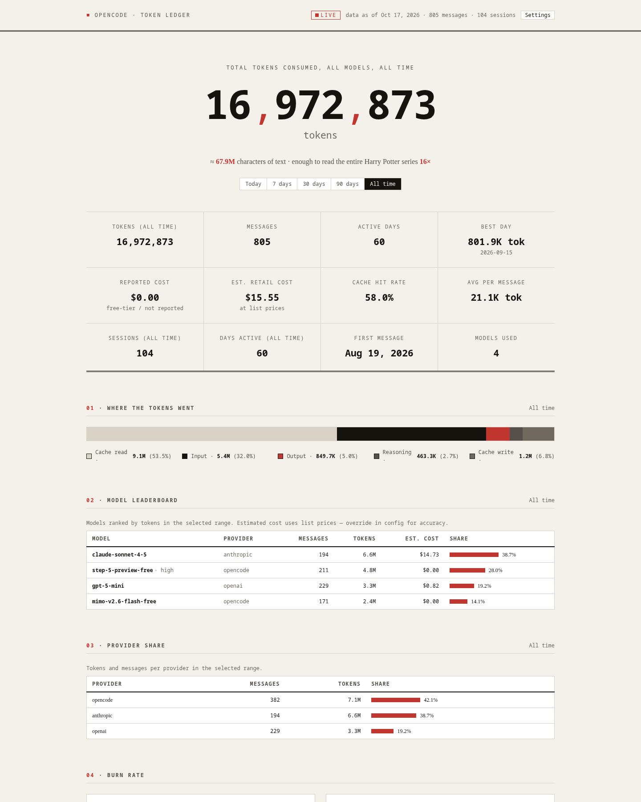
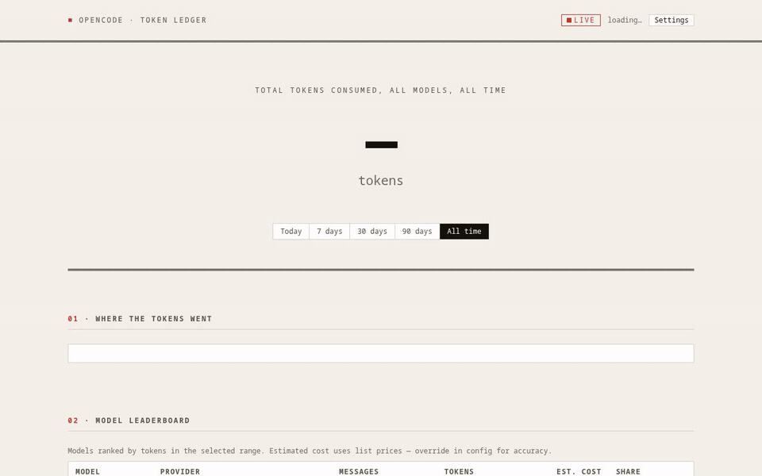

# opencode-ledger

[](https://github.com/0x-Shadow/opencode-ledger/actions/workflows/ci.yml)
[](LICENSE)
[](https://www.python.org/)
[](#why)

**Your personal token-usage ledger for OpenCode.** A private, self-hosted
dashboard that counts every token you have ever burned — lifetime odometer,
model leaderboard, burn-rate charts, weekday × hour heatmap, projects, agents,
estimated costs, budgets and alerts.

- 🔒 **Local-first.** Opens `opencode.db` *read-only*, emits aggregates only —
  message content never leaves the database, nothing leaves your machine.
- 📦 **Zero runtime dependencies.** Stdlib-only Python 3.10+, single-file UI,
  no CDNs, no build step.
- 📊 **Observable.** Prometheus `/metrics`, JSON API, CSV export, webhook budget
  alerts (Discord/Slack/ntfy), optional token auth.
- 🚀 **Easy to self-host.** One command locally, or Docker Compose, or a
  hardened systemd user unit.

```text
┌────────────────────────────────────────────────────────────────┐
│  TOTAL TOKENS CONSUMED, ALL TIME                               │
│                                                                │
│  1 697 287 318      ≈ 1.3 billion words · 27 156 books         │
│                                                                │
│  [Today] [7 days] [30 days] [90 days] [All time]               │
└────────────────────────────────────────────────────────────────┘
```





## Quickstart

### Local (no install)

```bash
python3 serve.py                       # live dashboard → http://localhost:8765/
./refresh.sh                           # (optional) one-shot stats.json extract
python3 serve.py --demo                # synthetic data, no database needed
```

### pipx / pip

```bash
pipx install git+https://github.com/0x-Shadow/opencode-ledger
opencode-ledger demo                   # instant demo, no database
opencode-ledger serve                  # the real thing
opencode-ledger extract                # write stats.json once
opencode-ledger check                  # evaluate budgets; exit 1 if over
opencode-ledger config                 # show effective configuration
```

Also runnable without installing: `python3 -m opencode_ledger serve`.

### Docker Compose

```bash
docker compose up -d --build           # → http://localhost:8765/
OPENCODE_DATA_DIR=/path/to/data docker compose up -d   # custom data dir
```

The stack mounts the OpenCode data directory **read-only**, runs as a non-root
user, and ships a healthcheck. See [docs/self-hosting.md](docs/self-hosting.md).

### systemd (user service)

```bash
pipx install .
deploy/install-systemd.sh              # hardened user unit + env-file sample
loginctl enable-linger "$USER"         # keep running when logged out
```

## What you get

| Section | What it shows |
| --- | --- |
| Odometer | Lifetime tokens (or current range), animated, with fun equivalences |
| Budgets | Daily/monthly token or USD budgets with progress bars |
| Where the tokens went | Input / output / reasoning / cache read / cache write split |
| Model leaderboard | Per model: messages, tokens, estimated cost, share |
| Provider share | Provider-level totals for the selected range |
| Burn rate | Daily and monthly charts from the day you started |
| When you burn | Weekday × hour heatmap (local time) |
| Projects | Tokens per project (session working directories) |
| Agents | Tokens per OpenCode agent |
| Heaviest sessions | Top sessions with cost, duration and project |

The whole page follows the range chips (Today / 7d / 30d / 90d / All time) and
auto-refreshes when the database changes — the ● LIVE badge shows the feed state.
A settings panel (theme, motion, poll interval, token) is stored in your browser.

## Configuration

Precedence: **CLI flags > `OPENCODE_LEDGER_*` env vars > config file > defaults**.
The config file is `ledger.json` in the working directory or
`~/.config/opencode-ledger/config.json`.

| Setting | Env var | Default | Notes |
| --- | --- | --- | --- |
| `db_path` | `OPENCODE_LEDGER_DB` | `~/.local/share/opencode/opencode.db` | Opened read-only |
| `host` / `port` | `OPENCODE_LEDGER_HOST` / `_PORT` | `127.0.0.1` / `8765` | `0` picks a free port |
| `token` | `OPENCODE_LEDGER_TOKEN` | *(none)* | Required on every route when set |
| `throttle_seconds` | `OPENCODE_LEDGER_THROTTLE` | `3.0` | Min seconds between re-extracts |
| `poll_seconds` | `OPENCODE_LEDGER_POLL` | `4` | UI refresh cadence |
| `budgets.daily_tokens` | `..._BUDGET_DAILY_TOKENS` | *(off)* | |
| `budgets.monthly_tokens` | `..._BUDGET_MONTHLY_TOKENS` | *(off)* | |
| `budgets.daily_cost_usd` | `..._BUDGET_DAILY_COST` | *(off)* | |
| `budgets.monthly_cost_usd` | `..._BUDGET_MONTHLY_COST` | *(off)* | |
| `alerts.thresholds` | `OPENCODE_LEDGER_ALERT_THRESHOLDS` | `[0.8, 1.0]` | Fractions of each budget |
| `alerts.webhook_url` | `OPENCODE_LEDGER_WEBHOOK_URL` | *(off)* | POST target |
| `alerts.webhook_format` | `OPENCODE_LEDGER_WEBHOOK_FORMAT` | `generic` | `generic`, `discord`, `slack`, `ntfy` |
| `pricing` | — | `{}` | Per-model list-price overrides |
| `pricing_file` | `OPENCODE_LEDGER_PRICING_FILE` | *(none)* | JSON file of overrides |

Example `ledger.json`:

```json
{
  "budgets": {"daily_cost_usd": 5, "monthly_tokens": 50000000},
  "alerts": {
    "webhook_url": "https://ntfy.sh/my-ledger-topic",
    "webhook_format": "ntfy"
  }
}
```

Full reference: [docs/configuration.md](docs/configuration.md).

### Alerts

When a budget crosses a threshold (80% and 100% by default) the server POSTs a
single summary per threshold per period — deduplicated in the state file, so
restarts do not spam you. Delivery is best-effort and never affects serving.
`opencode-ledger check` evaluates budgets once (cron-friendly, exit 1 when over);
`--no-alerts` skips webhook delivery.

## HTTP API

| Route | Description |
| --- | --- |
| `/` | The dashboard (single HTML file) |
| `/stats.json` (alias `/api/stats`) | Full aggregate document, `ETag` + 304 support |
| `/api/summary` | Compact totals + budget status |
| `/api/healthz` | Liveness + last extract info |
| `/api/export.csv` | Daily aggregates as CSV download |
| `/metrics` | Prometheus exposition |

With a token configured, send `Authorization: Bearer <token>`,
`X-Ledger-Token: <token>`, `?token=<token>` or a `ledger_token` cookie.
Full reference: [docs/api.md](docs/api.md).

Prometheus scrape example (`prometheus.yml`):

```yaml
scrape_configs:
  - job_name: opencode-ledger
    static_configs:
      - targets: ["127.0.0.1:8765"]
    authorization:
      credentials: your-token   # omit when no token is set
```

## Security

- Reads the database with `mode=ro` + busy timeout — safe next to a running
  OpenCode.
- Aggregates only: token counts, costs and *names* (models, providers, agents,
  projects, session titles). Message content is never extracted.
- Binds to `127.0.0.1` by default; set a token before exposing it anywhere.
  See the hardening checklist in [docs/self-hosting.md](docs/self-hosting.md).
- Costs are **list-price estimates, not provider billing data** — see
  [Cost estimation](docs/configuration.md#cost-estimation).
- Optional webhook alerts are the only outbound traffic, and only when you
  configure a URL (validated as `http(s)`).

See [SECURITY.md](SECURITY.md).

## Development

```bash
make smoke      # boot the demo server and check every route answers 200
make lint       # static checks (needs: pip install ruff)
make demo       # browse synthetic data at http://localhost:8765/
```

- `opencode_ledger/` — the package: extractor, config, pricing, budgets, alerts,
  metrics, server, CLI, UI.
- `serve.py`, `extract.py`, `refresh.sh` — v0-compatible shims.
- `Dockerfile`, `docker-compose.yml`, `deploy/` — deployment.
- `docs/` — configuration, API and self-hosting references.

PRs welcome — see [CONTRIBUTING.md](CONTRIBUTING.md).

## License

[MIT](LICENSE) © 2026 Nick (0x-Shadow)

---

*Not affiliated with the OpenCode project. It just reads its database.*
